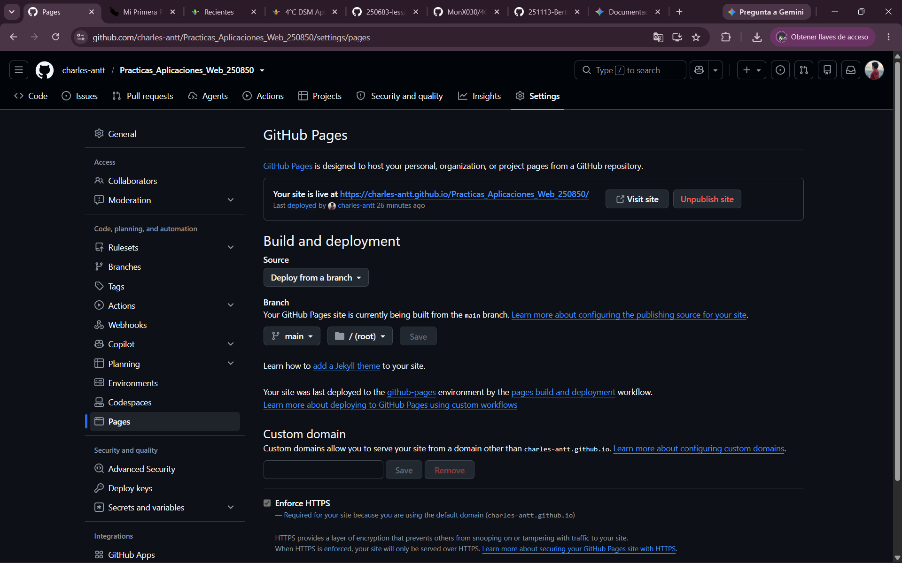

# Prácticas de la Asignatura de Aplicaciones Web
## T.S.U. en Desarrollo de Software Multiplataforma
### Docente: M.T.I. Marco Antonio Ramirez Hernández 

Periodo: Septiembre-Diciembre 

---
## 📸 Evidencia de Configuración
A continuación se muestra la captura de pantalla de la sección de **Settings > Pages** dentro del repositorio, confirmando la correcta activación y publicación del sitio web:

---

## 🛠️ Procedimiento Realizado

Para lograr la publicación del sitio web se siguieron los siguientes pasos:

1. **Estructuración del proyecto local:**
   * Se organizaron los archivos del sitio web asegurando que el archivo principal de entrada tuviera el nombre obligatorio `index.html` en la raíz del proyecto.
   * Se verificó que las rutas relativas a las hojas de estilo (CSS), archivos JavaScript y recursos multimedia (imágenes) estuvieran correctamente referenciadas.

2. **Control de versiones con Git y GitHub:**
   * Se inicializó el repositorio local con `git init`.
   * Se añadieron los cambios y se realizó el primer commit: `git commit -m "Initial commit: Portafolio web"`.
   * Se vinculó el repositorio local con el remoto en GitHub y se subió la rama principal (`main`).

3. **Configuración de GitHub Pages:**
   * Dentro del repositorio en GitHub, se navegó a la sección de **Settings** (Configuración).
   * En el menú lateral izquierdo, se seleccionó la opción **Pages**.
   * En la sección **Build and deployment**:
     * **Source:** Se eligió la opción `Deploy from a branch`.
     * **Branch:** Se seleccionó la rama `main` y la carpeta `/ (root)`.
   * Se guardaron los cambios y se esperó un par de minutos a que el flujo de trabajo de **GitHub Actions** finalizara la compilación e implementación automática.

---

## ⚠️ Dificultades Encontradas y Soluciones Implementadas

1. **Dificultad:** El sitio mostraba un error `404 Not Found` al intentar acceder a la URL generada.
   * **Causa:** El archivo principal no se llamaba `index.html` o no estaba ubicado en la raíz (`root`) del repositorio.
   * **Solución:** Se renombró el archivo de inicio a `index.html` y se movió a la raíz del repositorio, realizando un nuevo `git push`.

2. **Dificultad:** Las imágenes o los estilos CSS no se cargaban correctamente en la página publicada (aparecía la página "roto" sin diseño).
   * **Causa:** Las rutas de los archivos eran absolutas (ej. `/src/style.css` o `C:/Users/...`) en lugar de relativas.
   * **Solución:** Se ajustaron todas las rutas dentro del HTML a formatos relativos (ej. `./css/style.css` y `./assets/imagen.png`).

3. **Dificultad:** Tiempo de espera al reflejar cambios actualizados.
   * **Causa:** El caché del navegador o el retraso en el despliegue automático de GitHub Pages.
   * **Solución:** Se forzó el refresco del navegador sin caché (`Ctrl + F5` / `Cmd + Shift + R`) y se monitoreó la pestaña **Actions** en GitHub para confirmar que el despliegue estuviera marcado como completado (check verde).

---

## 🚀 Conclusión
Gracias a este reto autónomo, se logró alojar un sitio web estático accesible globalmente de forma gratuita, adquiriendo experiencia práctica en el flujo de trabajo de desarrollo web con Git y despliegue continuo mediante GitHub Pages.

### Tabla de Practicas de la Materia 

|No. | Nombre  | Descripción  | Potenciador  | Estatus  |
|---|---|---|---|---|
|1.  |Metodología de Evaluación de la materia.| Transcribir en libreta y comprender la metodología y fechas de evaluación de la asignatura.| 5 | 🟢 Concluida |
|2.  |Mi Primer Página Web.| Codificar la primer página web con HTML puro, sin estilos ni funcionalidades.| 10 | 🟢 Concluida |
|3.  |Mi Primer Página Web.| Codificación de primer página web| 30 | 🟢 Concluida |
|4.  |Mi Primer Página Web en GitHub Pages.| Hospedaje de la página web| 10 | 🟢 Concluida |